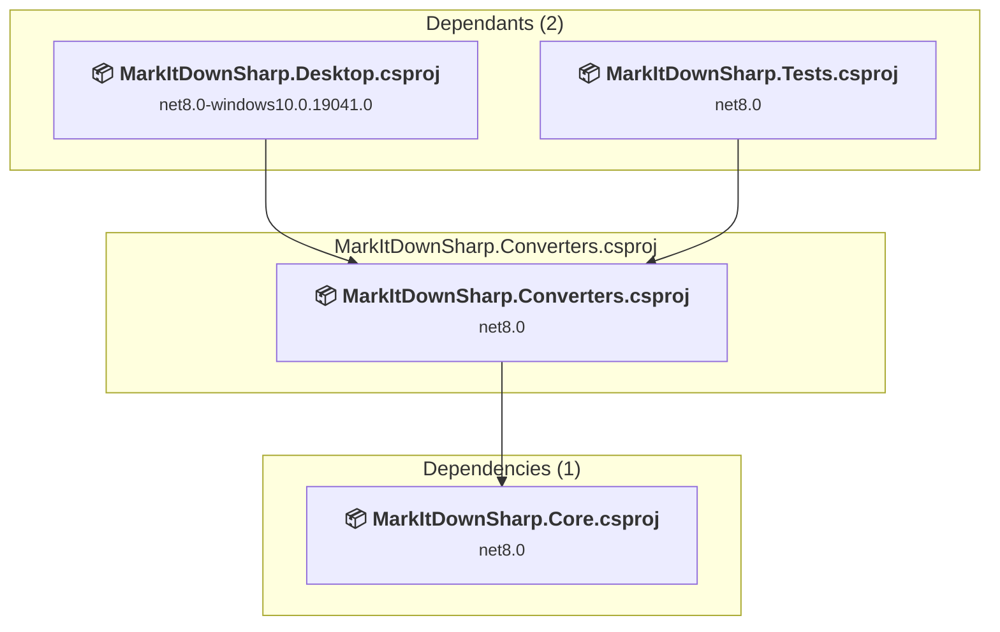

# src\MarkItDownSharp.Converters\MarkItDownSharp.Converters.csproj

[← Back to the assessment index](../../assessment.md)

## Project Info

- **Current Target Framework:** net8.0
- **Proposed Target Framework:** net11.0
- **SDK-style**: True
- **Project Kind:** ClassLibrary
- **Dependencies**: 1
- **Dependants**: 2
- **Number of Files**: 4
- **Number of Files with Incidents**: 1
- **Lines of Code**: 169
- **Estimated LOC to modify**: 0+ (at least 0.0% of the project)

## Related Projects

**Depends on (1)** — projects this one references:

- [D:\Development\Source\Repos\russgreen\MarkItDownSharp\src\MarkItDownSharp.Core\MarkItDownSharp.Core.csproj](../projects/MarkItDownSharp.Core.md)

**Depended on by (2)** — projects that reference this one:

- [D:\Development\Source\Repos\russgreen\MarkItDownSharp\src\MarkItDownSharp.Desktop\MarkItDownSharp.Desktop.csproj](../projects/MarkItDownSharp.Desktop.md)
- [D:\Development\Source\Repos\russgreen\MarkItDownSharp\tests\MarkItDownSharp.Tests\MarkItDownSharp.Tests.csproj](../projects/MarkItDownSharp.Tests.md)

## Dependency Graph

Legend:
📦 SDK-style project
⚙️ Classic project

## API Compatibility

| Category | Count | Impact |
| :--- | :---: | :--- |
| 🔴 Binary Incompatible | 0 | High - Require code changes |
| 🟡 Source Incompatible | 0 | Medium - Needs re-compilation and potential conflicting API error fixing |
| 🔵 Behavioral change | 0 | Low - Behavioral changes that may require testing at runtime |
| ✅ Compatible | 288 |  |
| ***Total APIs Analyzed*** | ***288*** |  |

