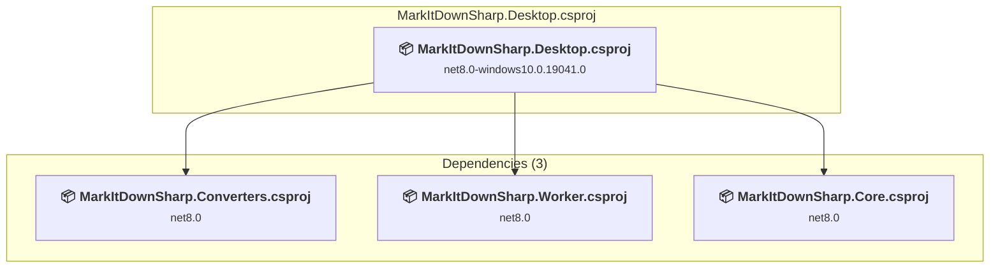

# src\MarkItDownSharp.Desktop\MarkItDownSharp.Desktop.csproj

[← Back to the assessment index](../../assessment.md)

## Project Info

- **Current Target Framework:** net8.0-windows10.0.19041.0
- **Proposed Target Framework:** net11.0-windows10.0.22000.0
- **SDK-style**: True
- **Project Kind:** WinForms
- **Dependencies**: 3
- **Dependants**: 0
- **Number of Files**: 11
- **Number of Files with Incidents**: 1
- **Lines of Code**: 321
- **Estimated LOC to modify**: 0+ (at least 0.0% of the project)

## Related Projects

**Depends on (3)** — projects this one references:

- [D:\Development\Source\Repos\russgreen\MarkItDownSharp\src\MarkItDownSharp.Converters\MarkItDownSharp.Converters.csproj](../projects/MarkItDownSharp.Converters.md)
- [D:\Development\Source\Repos\russgreen\MarkItDownSharp\src\MarkItDownSharp.Core\MarkItDownSharp.Core.csproj](../projects/MarkItDownSharp.Core.md)
- [D:\Development\Source\Repos\russgreen\MarkItDownSharp\src\MarkItDownSharp.Worker\MarkItDownSharp.Worker.csproj](../projects/MarkItDownSharp.Worker.md)

## Dependency Graph

Legend:
📦 SDK-style project
⚙️ Classic project

## API Compatibility

| Category | Count | Impact |
| :--- | :---: | :--- |
| 🔴 Binary Incompatible | 0 | High - Require code changes |
| 🟡 Source Incompatible | 0 | Medium - Needs re-compilation and potential conflicting API error fixing |
| 🔵 Behavioral change | 0 | Low - Behavioral changes that may require testing at runtime |
| ✅ Compatible | 183 |  |
| ***Total APIs Analyzed*** | ***183*** |  |

## NuGet Package Issues

| Package | Current Version | Suggested Version | Severity | Issue |
| :--- | :---: | :---: | :---: | :--- |
| Microsoft.WindowsAppSDK | 1.6.250108002 | 2.7.0 | 🔴 Mandatory | NuGet package is incompatible |

Every project affected by these packages, and the versions the repository settles on: [aggregate NuGet packages](../nuget/aggregate-packages.md).

